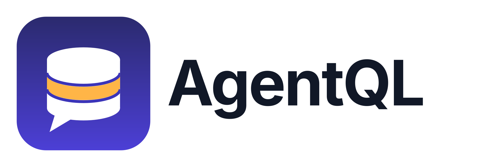
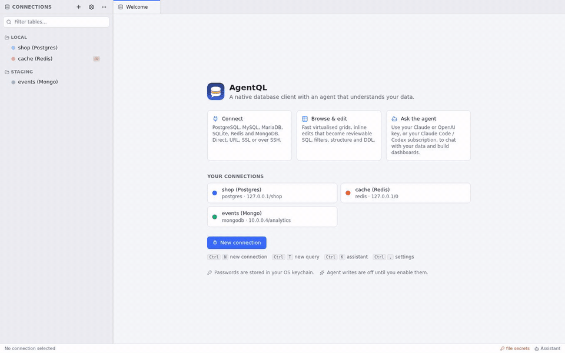
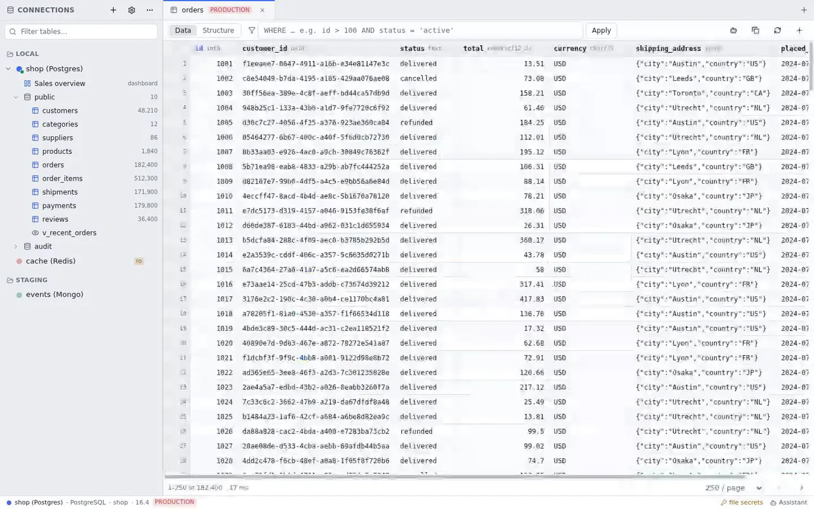
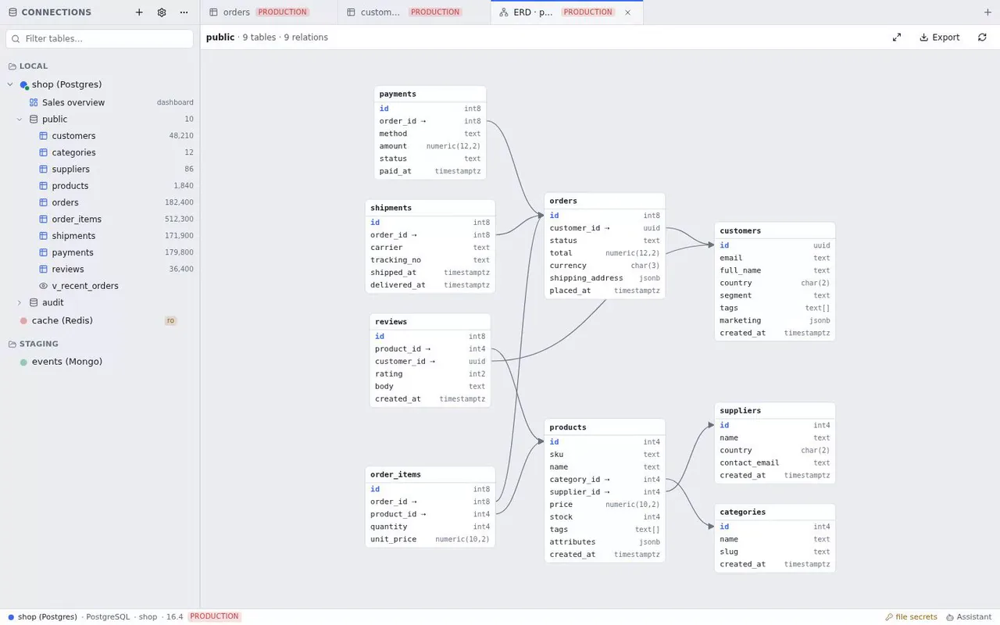
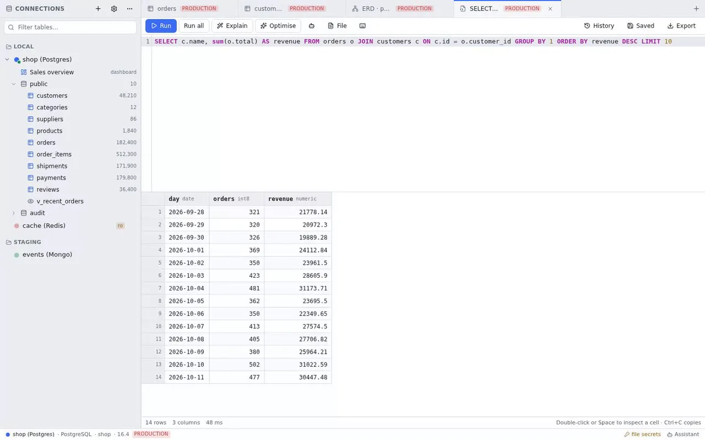
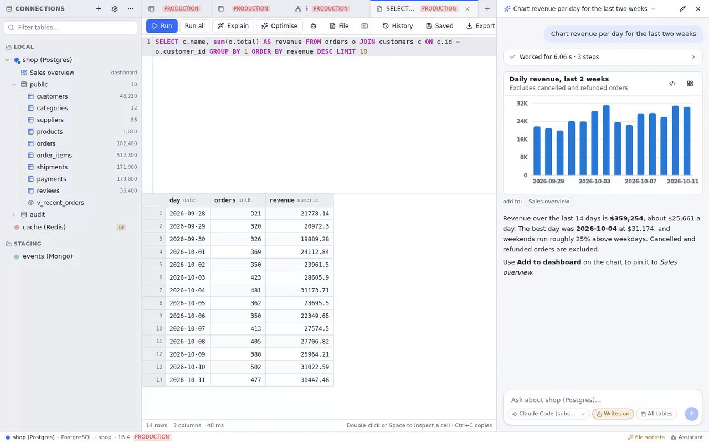
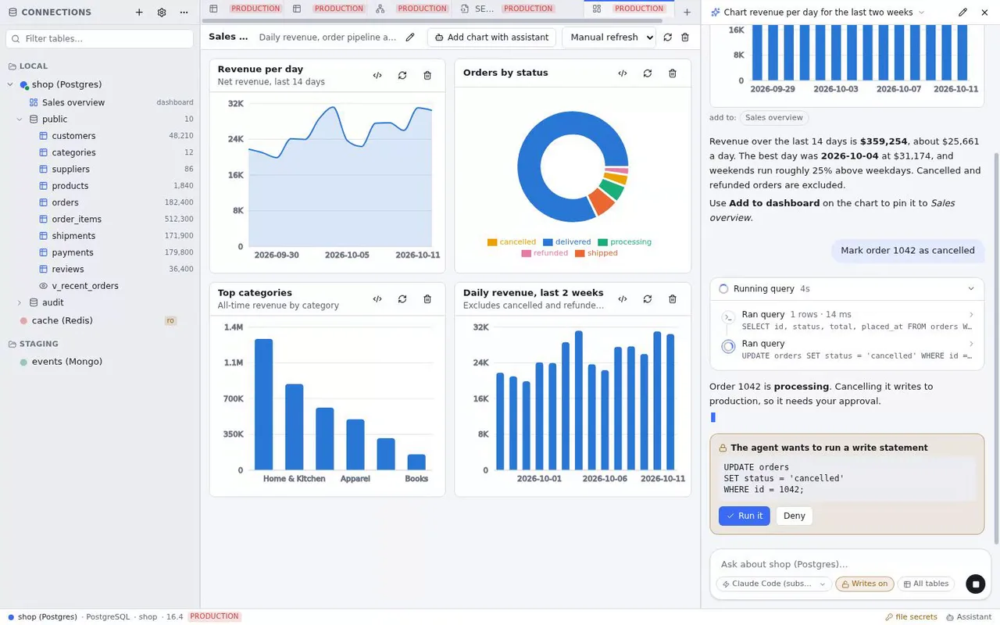
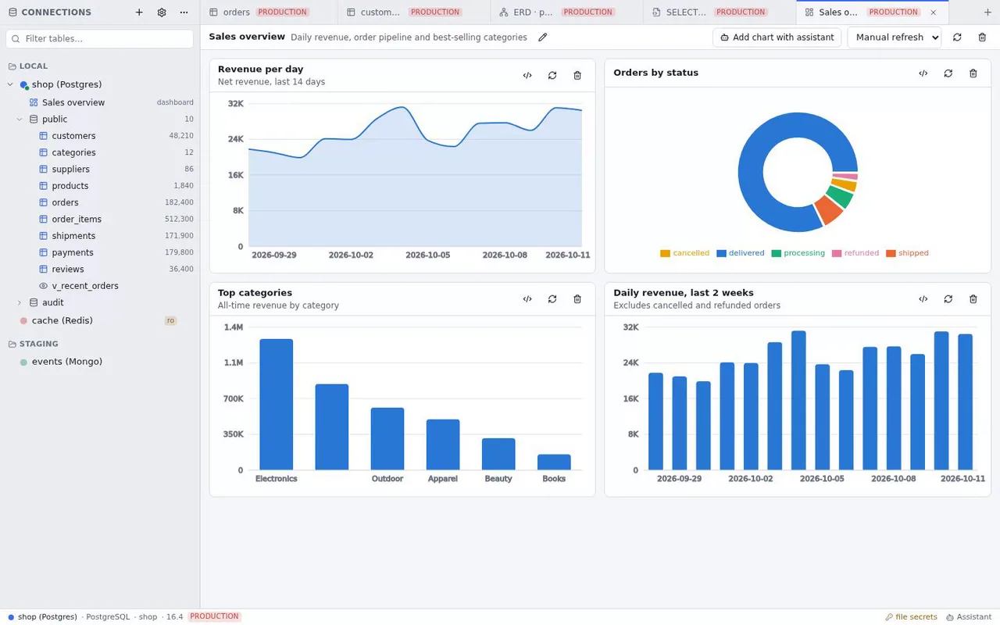
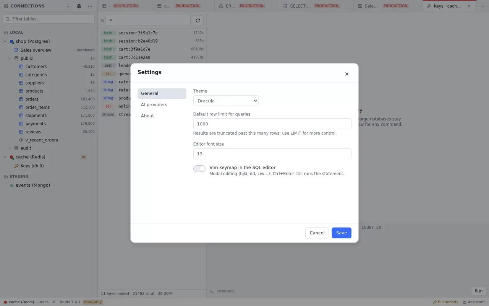

<p align="center">
  <picture>
    <source media="(prefers-color-scheme: dark)" srcset="assets/brand/logo.svg">
    
  </picture>
</p>

# AgentQL

[](https://github.com/OpenSkye-Labs/agentQL/actions/workflows/ci.yml)
[](https://github.com/OpenSkye-Labs/agentQL/actions/workflows/release.yml)
[](https://github.com/OpenSkye-Labs/agentQL/releases/latest)

<p align="center">
  English · <a href="README.zh-CN.md">简体中文</a> · <a href="README.ja.md">日本語</a> · <a href="README.ko.md">한국어</a> · <a href="README.es.md">Español</a> · <a href="README.pt-BR.md">Português</a> · <a href="README.de.md">Deutsch</a> · <a href="README.fr.md">Français</a>
</p>

<p align="center">
  
  <br>
  <sub>Walkthrough on the built-in demo dataset: browse, ER diagram, query, ask the agent for a chart, a write that needs your approval, dashboard.</sub>
</p>

A native, cross-platform database client with an agent built in. Think TablePlus / DBeaver, plus an assistant
that can read your schema, run queries, optimise SQL and build dashboards — using **your** Claude or OpenAI API
key, or your existing **Claude Code** / **Codex (ChatGPT)** subscription.

Built with Tauri 2 + Rust (sqlx, redis, mongodb, russh, axum) and React 19 + TypeScript.

## Databases

PostgreSQL · MySQL · MariaDB · SQLite · Redis · MongoDB

Connect with host/credentials or a URL, with SSL (require / verify-ca / verify-full, client certs) and through an
SSH tunnel (agent, key file, or password). Passwords live in the OS keychain.

## Highlights

- **Query editor** — CodeMirror with dialect-aware highlighting and schema completion. `Ctrl/⌘+Enter` runs the
  statement under the cursor; multi-statement scripts return one result per statement; EXPLAIN / EXPLAIN ANALYZE.
- **Grid** — virtualised, keyboard-navigable, cell inspector, copy as TSV/JSON, export CSV/JSON/SQL.
- **Table browser** — filter (WHERE), sort, paging, inline edits that become reviewable SQL applied in one
  transaction; structure view with indexes, foreign keys and DDL.
- **Redis** — SCAN-based key browser with typed viewers, TTL, and a console. **MongoDB** — find/aggregate, JSON or
  table view, edit/insert/delete documents, collection info.
- **Assistant** — streams answers, calls tools (schema, run_sql, explain, charts), asks for approval before any
  write, renders charts inline and proposes whole dashboards you can save and auto-refresh.
- **Safety** — read-only connections and agent reads are enforced _by the database_ (READ ONLY transactions /
  `PRAGMA query_only`), not just by parsing.

## What it looks like

<table>
  <tr>
    <td width="50%"><br><sub><b>Grid</b> · virtualised, keyboard-first, inline edits become reviewable SQL, FK click-through, environment badges.</sub></td>
    <td width="50%"><br><sub><b>ER diagram</b> · auto-laid-out from the live catalogue; click a table to open it, export SVG/PNG. Schema diff with copy-as-migration next door.</sub></td>
  </tr>
  <tr>
    <td><br><sub><b>Editor</b> · alias-aware completion, JOIN suggestions from foreign keys, run the statement under the cursor, EXPLAIN, vim keymap, snippets, saved-query versions.</sub></td>
    <td><br><sub><b>Agent</b> · inspects the schema, writes and runs SQL, explains the result and returns a chart you can pin to a dashboard. Every step is visible.</sub></td>
  </tr>
  <tr>
    <td><br><sub><b>Writes need your approval</b> · reads run in a database-enforced read-only context (READ ONLY transactions on Postgres and MySQL, <code>PRAGMA query_only</code> on SQLite); a write stops on an approval card showing the exact statement.</sub></td>
    <td><br><sub><b>Dashboards</b> · charts from your queries or the agent's, auto-refresh, and the agent can propose a whole dashboard.</sub></td>
  </tr>
  <tr>
    <td colspan="2"><br><sub><b>Redis and MongoDB too</b> · SCAN-based key browser with a console, Mongo find/aggregate and document editing. Ten themes, Dracula shown; Follow-system works on Linux, macOS and Windows.</sub></td>
  </tr>
</table>

### How agentic is it?

The assistant is a tool-using agent, not a text box that pastes SQL. On each turn it can list tables, describe
columns and foreign keys, run read-only SQL, explain a plan, create a chart, propose a dashboard, scan Redis or query
MongoDB, and it shows every step with the query it ran and the rows it got back. The guard rails are enforced below
the model, not in the prompt: reads run in a database-enforced read-only context (`READ ONLY` transactions on
Postgres and MySQL, `PRAGMA query_only` on SQLite), writes stop on an approval card with the exact statement, each
connection can scope which schemas and tables the agent may see, and every SQL statement it runs lands in the
normal query history tagged `agent`. It works with your Anthropic or OpenAI key, any OpenAI-compatible
endpoint such as Ollama, or your existing Claude Code or Codex CLI subscription through a local MCP endpoint.

## Install

Download the installer for your platform from the [latest release](https://github.com/OpenSkye-Labs/agentQL/releases/latest):
macOS (Apple Silicon and Intel), Windows, and Linux (`.deb`, `.rpm`, `.AppImage`). The app checks for updates on
startup and installs them in place.

## Build from source

```bash
pnpm install
pnpm tauri dev        # desktop app
pnpm tauri build      # installers for your OS
```

Linux needs the usual Tauri prerequisites (webkit2gtk 4.1, gtk3, libssl). See `docs/TESTING.md` for throwaway
database containers and the live driver tests.

## AI providers

Settings → AI providers. Add one or more of:

- Anthropic API (key), OpenAI API (key), any OpenAI-compatible endpoint (Ollama, OpenRouter, Groq, …)
- Claude Code CLI or Codex CLI — uses the login you already have; the app exposes its database tools to the CLI
  over a local, token-protected MCP endpoint, so approvals and tool cards work the same way.

Agent writes are off by default; enabling them still requires a per-statement approval in the chat.

## Contributing

Pull requests are welcome. [CONTRIBUTING.md](CONTRIBUTING.md) covers branches, checks, and how releases are cut.

## Code signing policy

Release builds are produced only by the public [release workflow](.github/workflows/release.yml) in this repository.
Windows installers are to be signed through [SignPath.io](https://signpath.io) with a certificate from the
[SignPath Foundation](https://signpath.org) (application pending). Updater artifacts are additionally signed with
the project's minisign key, and the app verifies that signature before installing an update.

- Committers and reviewers: [@aindong](https://github.com/aindong)
- Approvers: [@aindong](https://github.com/aindong)

## Privacy policy

AgentQL does not transfer any information to other networked systems unless specifically requested by the user or
the person installing or operating it. In practice it connects to:

- the databases and SSH hosts you add as connections, when you use them;
- the AI provider you configure (Anthropic, OpenAI, an OpenAI-compatible endpoint, or your local Claude Code /
  Codex CLI), only when you send a message to the assistant;
- `github.com`, once at startup, to check whether a newer release exists.

No telemetry, analytics or crash reports are sent. Credentials are stored in the OS keychain or, when none is
available, in a local file in the app data directory.

## License

[MIT](LICENSE).

## Docs

`CLAUDE.md` (repo guide) · `docs/PLAN.md` · `docs/ARCHITECTURE.md` · `docs/TASKS.md` · `docs/FEATURES.md` ·
`docs/REVIEWS.md` · `docs/TESTING.md`
